<div align="center">


# VisitFlow

**Daha güvenli tesisler, daha verimli ziyaretler.**

Davetten kapıdaki girişe kadar kurumsal ziyaretçi yönetimi:<br />
KVKK onayı · atlanamaz İSG eğitimi · QR geçiş · değiştirilemez denetim kaydı


[Özellikler](#-özellikler) · [Ekranlar](#-ekranlar) · [Kurulum](#-hızlı-başlangıç) · [SSO](#-kurumsal-sso) · [Güvenlik](#-güvenlik-tasarımı) · [Lisans](#-lisans)

</div>

<br />

<p align="center">
  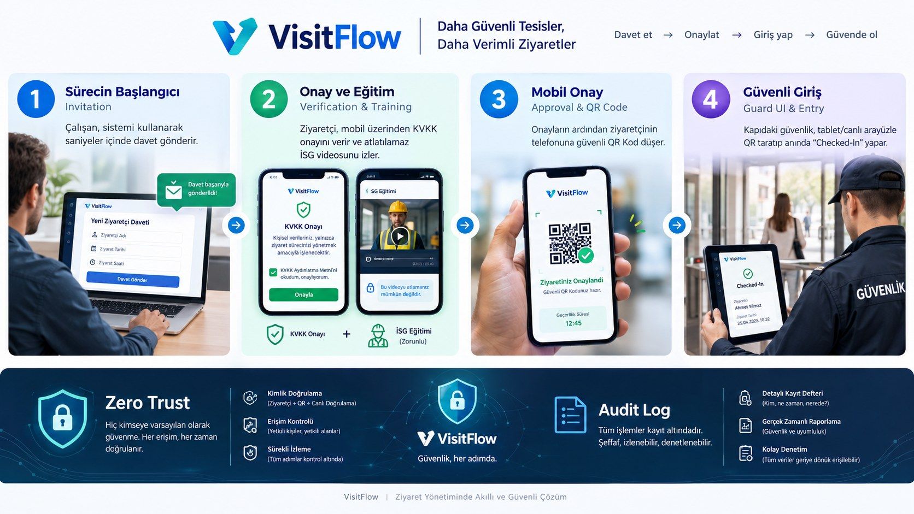
</p>

---

## ✨ Özellikler

<table>
<tr>
<td width="50%" valign="top">

### 1 · Çalışan portalı
Ziyaretçi adı, soyadı, e-posta, telefon, plaka (opsiyonel), ziyaret amacı, birim ve tahmini varışla **saniyeler içinde davet**. Kendi davetlerini izleme, iptal ve yeniden gönderme.

</td>
<td width="50%" valign="top">

### 2 · Ziyaretçi ön kaydı
Tek kullanımlık, süreli bağlantı (`/visitor/verify?token=…`). **KVKK onayı** (zaman, IP, User-Agent, metin sürümü ve SHA-256 özeti kaydedilir) ve **ileri sarılamayan İSG videosu**; sunucu izlemeyi gerçek zamana göre doğrular.

</td>
</tr>
<tr>
<td valign="top">

### 3 · QR geçiş
Onayda ziyaretçinin telefonuna ve e-postasına **süreli, tek ziyaretlik QR kod**; çalışana ve güvenliğe özet bildirim.

</td>
<td valign="top">

### 4 · Güvenlik paneli
Tablet öncelikli, **canlı** (SignalR) "Gelecekler / İçeride / Çıkış yapanlar" panosu. Kamera veya el terminaliyle QR okuma, **tek dokunuşla** giriş/çıkış.

</td>
</tr>
</table>

**Ayrıca:** ilk kurulum sihirbazı · kullanıcı/rol yönetimi · birim ve lokasyon yönetimi · **panelden SSO ve SMTP yönetimi** (yeniden başlatma gerektirmez) · SSO ile gelen kullanıcılar için **otomatik / yönetici onaylı / yalnızca davetli** giriş politikası · KVKK metin sürümleri · kurumsal tema · hash zincirli denetim izi · saklama süresi dolan kişisel verilerin otomatik anonimleştirilmesi.

## 🖼 Ekranlar

### Çalışan portalı ve güvenlik

<table>
<tr>
<td width="50%">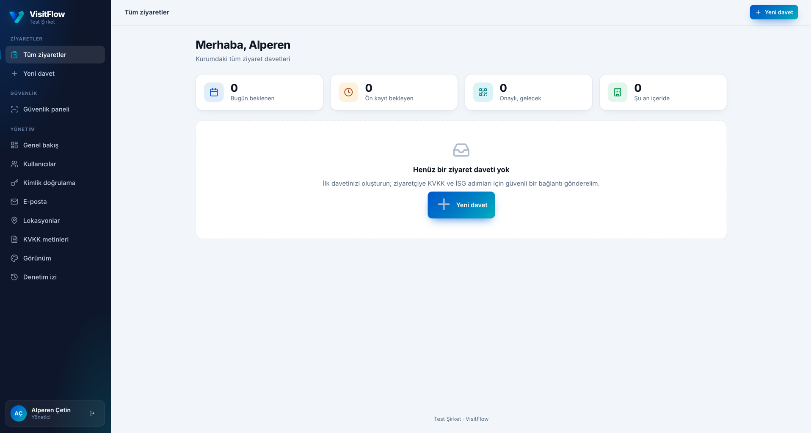<p align="center"><sub><b>Ziyaretler</b> – bugün beklenen, ön kayıt bekleyen, onaylı ve içerideki ziyaretçiler</sub></p></td>
<td width="50%">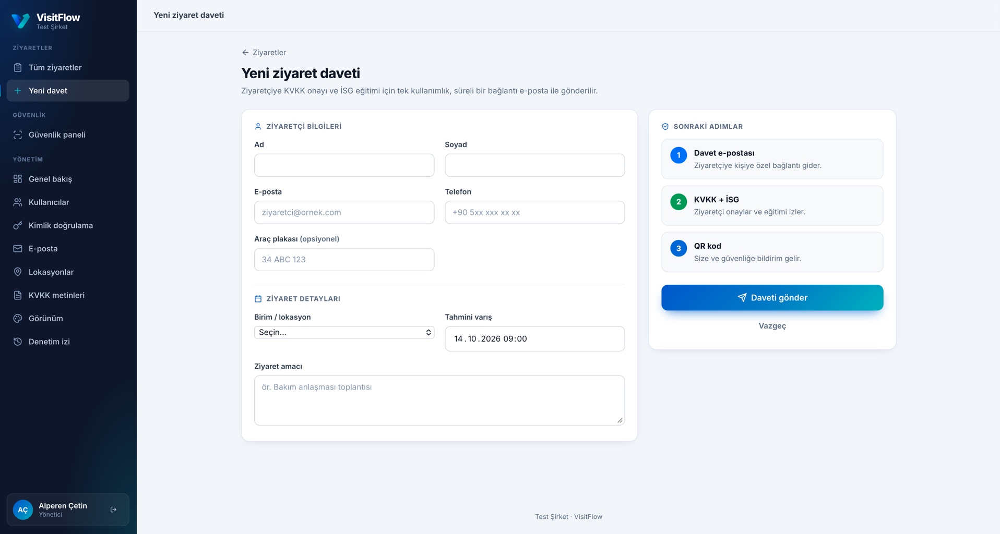<p align="center"><sub><b>Yeni davet</b> – ziyaretçi bilgileri, birim/lokasyon ve tahmini varış</sub></p></td>
</tr>
<tr>
<td>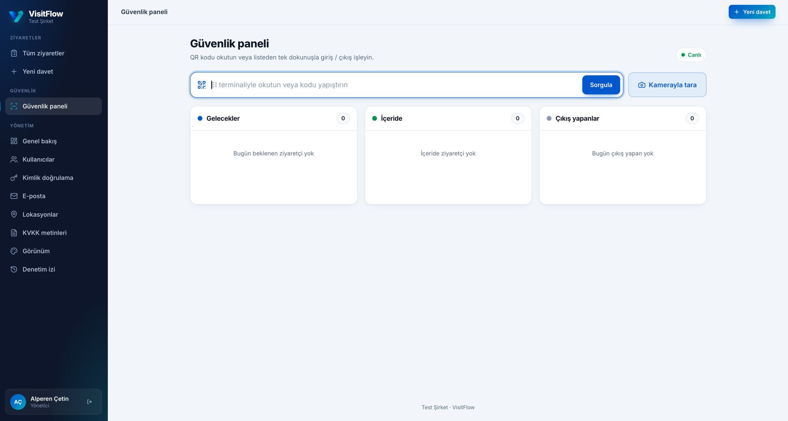<p align="center"><sub><b>Güvenlik paneli</b> – canlı pano, el terminali veya kamerayla QR okuma</sub></p></td>
<td>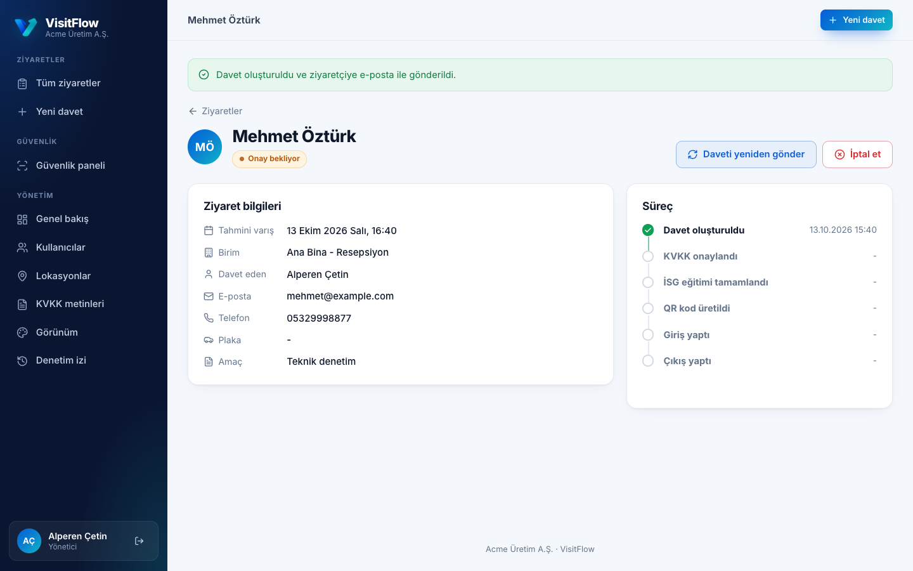<p align="center"><sub><b>Ziyaret detayı</b> – süreç adımları ve işlemler</sub></p></td>
</tr>
</table>

### Yönetim paneli

<table>
<tr>
<td width="50%">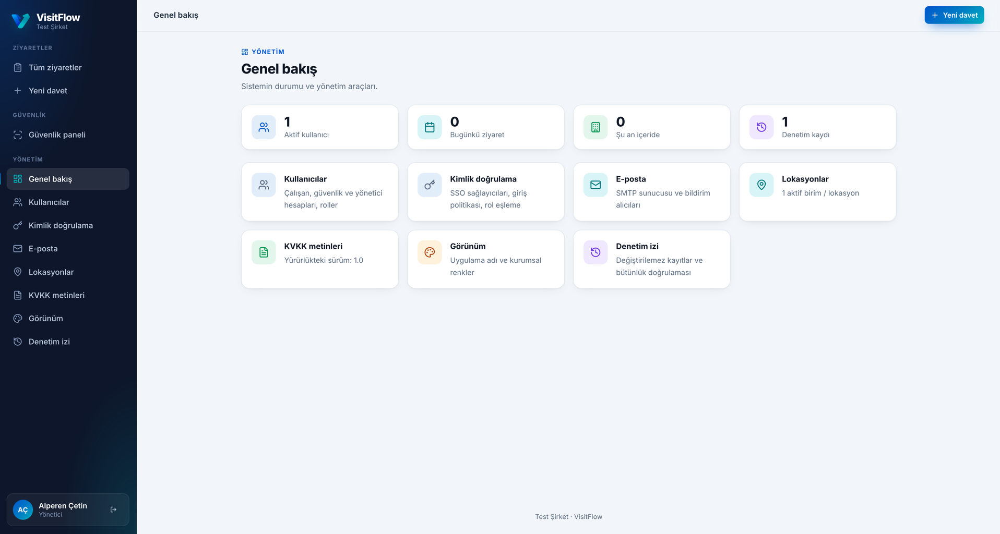<p align="center"><sub><b>Genel bakış</b> – sistem durumu ve yönetim araçları</sub></p></td>
<td width="50%">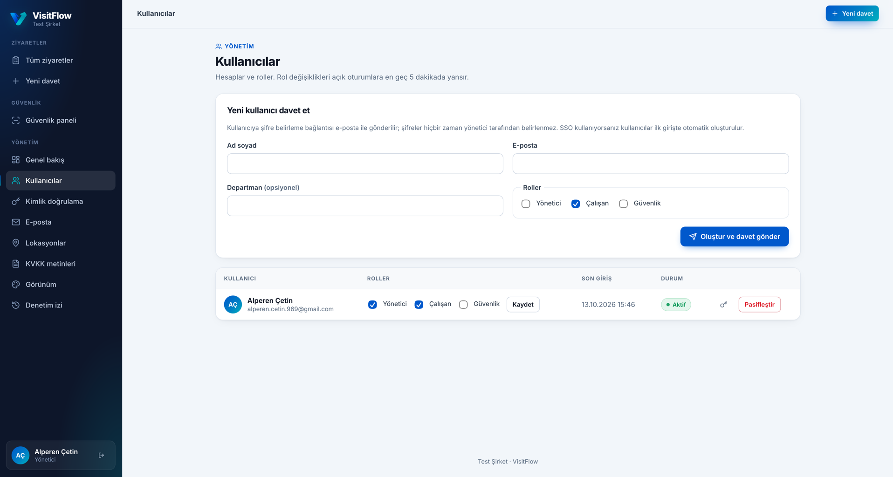<p align="center"><sub><b>Kullanıcılar</b> – davet, roller, pasifleştirme</sub></p></td>
</tr>
<tr>
<td>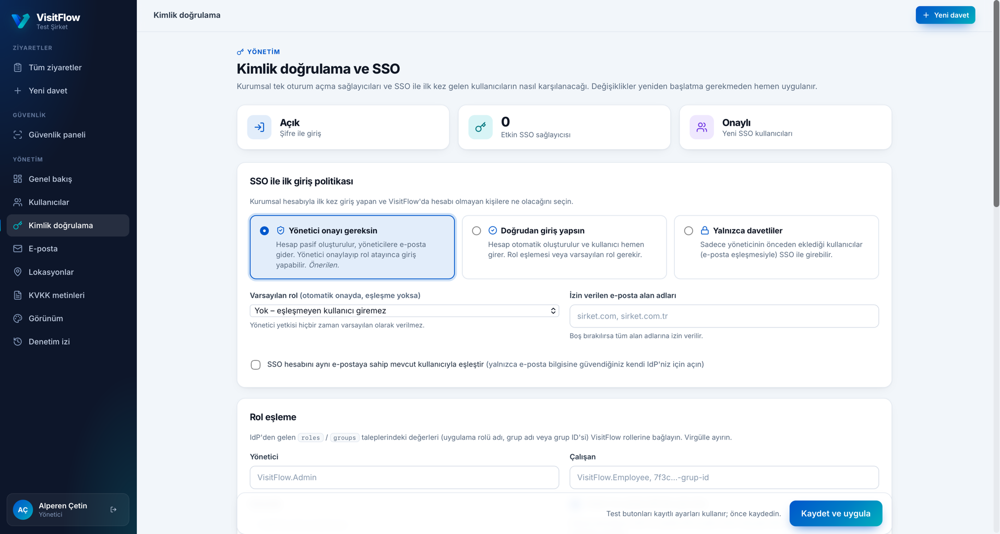<p align="center"><sub><b>Kimlik doğrulama</b> – SSO, ilk giriş politikası ve rol eşleme</sub></p></td>
<td>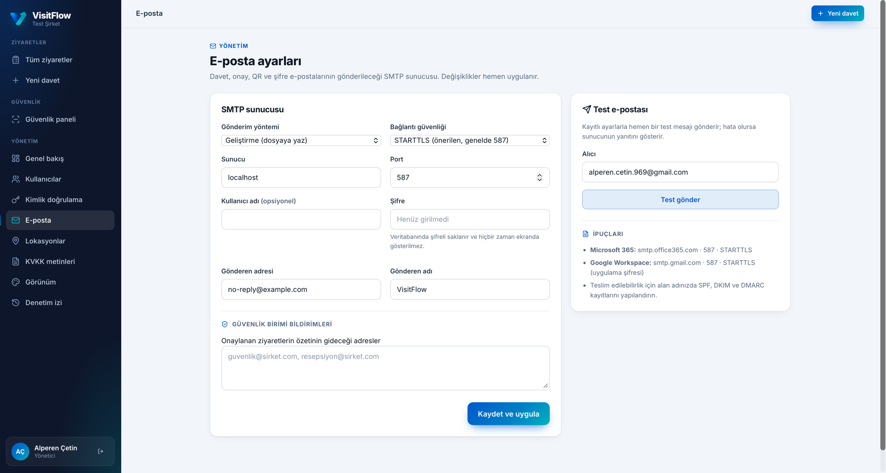<p align="center"><sub><b>E-posta</b> – SMTP, test e-postası ve güvenlik birimi bildirimleri</sub></p></td>
</tr>
<tr>
<td>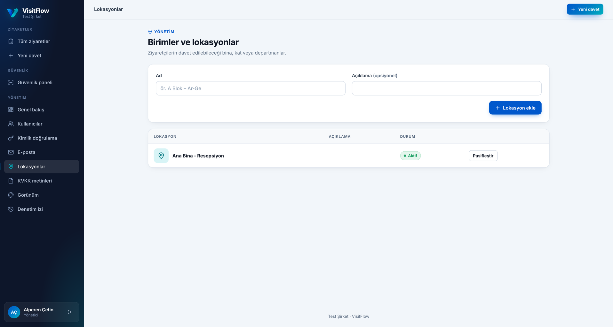<p align="center"><sub><b>Lokasyonlar</b> – ziyaret edilebilecek bina, kat ve birimler</sub></p></td>
<td>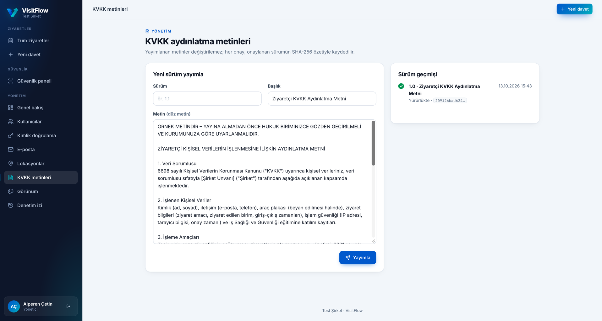<p align="center"><sub><b>KVKK metinleri</b> – değiştirilemez, sürümlü ve SHA-256 özetli</sub></p></td>
</tr>
<tr>
<td>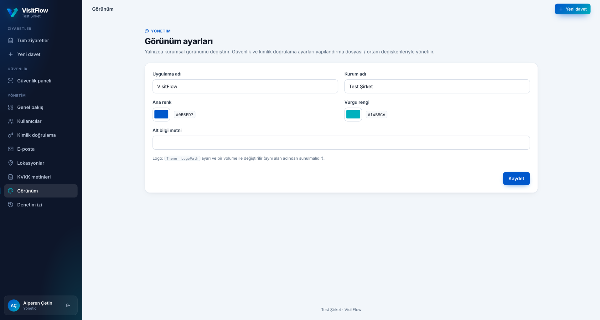<p align="center"><sub><b>Görünüm</b> – uygulama adı, kurum adı ve kurumsal renkler</sub></p></td>
<td>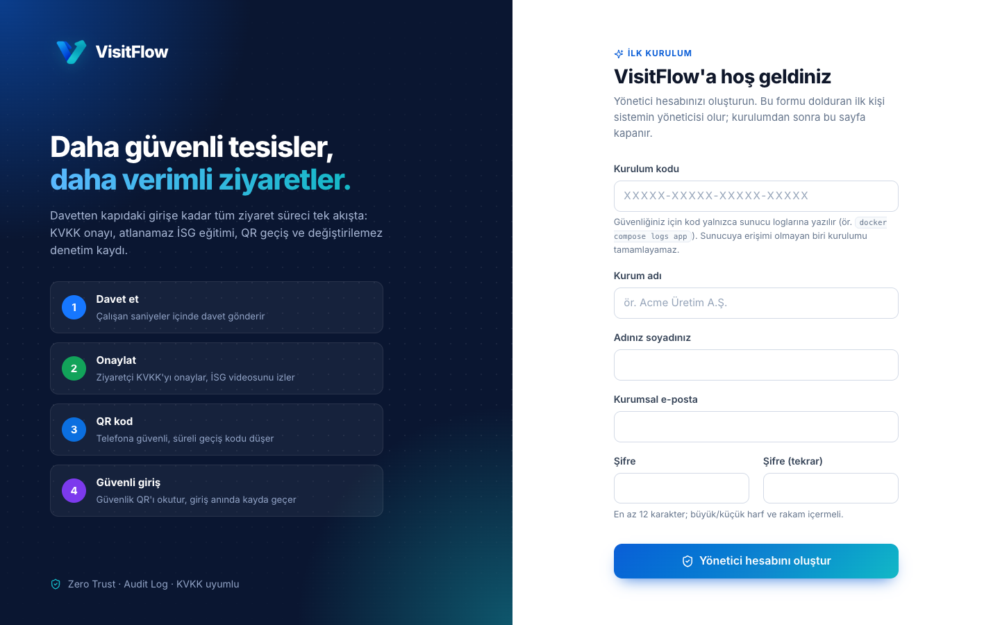<p align="center"><sub><b>İlk kurulum sihirbazı</b> – tek seferlik kodla ilk yönetici</sub></p></td>
</tr>
</table>

### Giriş ve ziyaretçi akışı

<p align="center">
  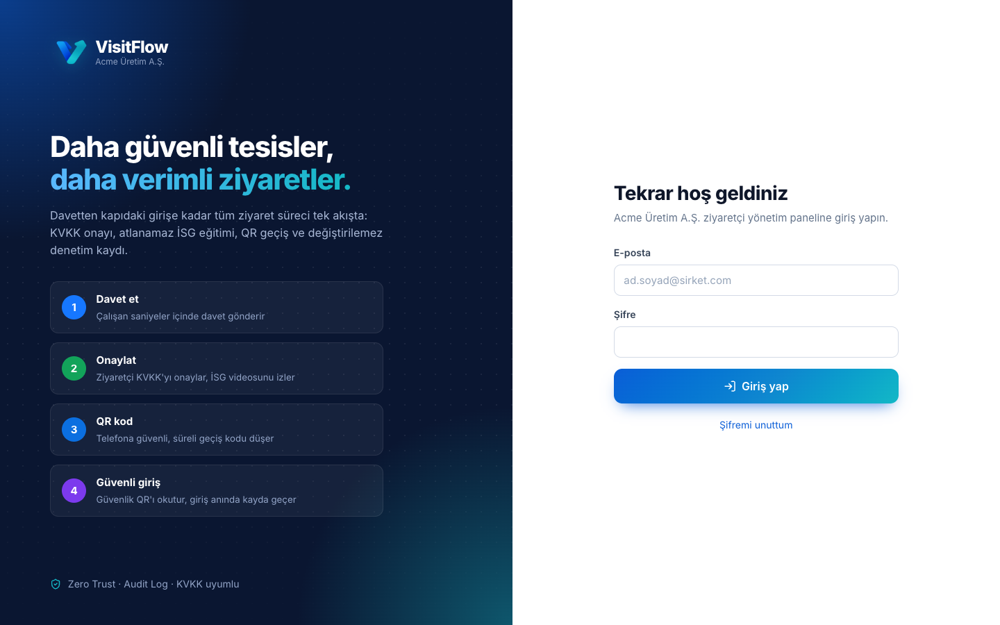<br />
  <sub><b>Giriş ekranı</b></sub>
</p>

<p align="center">
  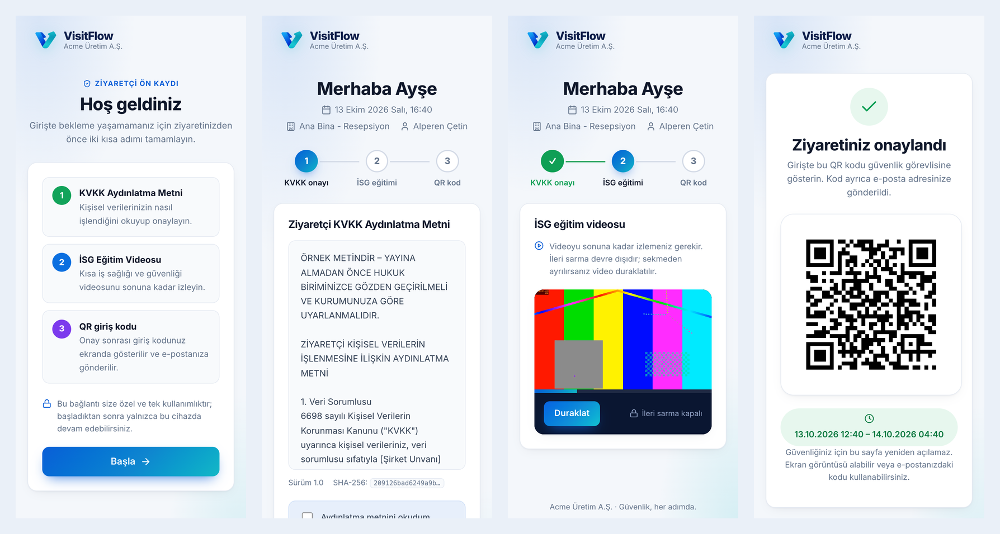<br />
  <sub><b>Ziyaretçi akışı (mobil):</b> karşılama → KVKK onayı → ileri sarılamayan İSG videosu → QR giriş kodu</sub>
</p>

## 🚀 Hızlı başlangıç

### Docker (hazır imaj — kaynak kod gerekmez)

VisitFlow, GitHub Container Registry üzerinden hazır imaj olarak dağıtılır: `ghcr.io/alperenncetinn/visitflow` (linux/amd64 ve linux/arm64). Gereksinim: Docker Engine 24+ ve Docker Compose v2.

```bash
git clone https://github.com/alperenncetinn/VisitFlow.git && cd VisitFlow   # yalnızca dağıtım dosyaları
cp .env.example .env                       # POSTGRES_OWNER_PASSWORD ve POSTGRES_APP_PASSWORD'ü doldurun
docker compose pull
docker compose --profile dev up -d         # --profile dev: test için Mailpit e-posta yakalayıcısı
docker compose logs app | grep -A1 "KURULUM KODU"
```

1. **https://localhost/Setup** adresini açın.
2. Logdaki **kurulum kodunu**, kurum adını ve yönetici bilgilerinizi girin.
3. Formu dolduran **ilk kişi yönetici olur**; kurulumdan sonra sihirbaz kalıcı olarak kapanır.

> **Neden kurulum kodu?** "İlk gelen yönetici olur" mantığı tek başına, internete yeni açılmış bir sunucuyu sizden önce bulan herkese (botlar dahil) yönetici hesabı verir. Kod yalnızca sunucu loguna yazıldığı için ilk yönetici, sunucuya erişimi olan kişi olur. Kod her yeniden başlatmada değişir.

- Geliştirme e-postaları (Mailpit): http://localhost:8025
- İSG videosunu `media/isg-egitim.mp4` olarak koyun ve `TRAINING_DURATION_SECONDS` değerini videonun süresine eşitleyin.
- Gerçek alan adında `VISITFLOW_DOMAIN=ziyaret.sirketiniz.com` verdiğinizde Caddy, Let's Encrypt sertifikasını otomatik alır. Üretimde `--profile dev` kullanmayın ve SMTP'yi gerçek sunucunuza yönlendirin.
- Üretimde `.env` içinde `VISITFLOW_VERSION=1.0.0` gibi sabit bir sürüm kullanın; `latest` yükseltmeleri kontrolsüz hale getirir.

**Portlar, volume'ler ve ortam değişkenleri**

| | Değer | Açıklama |
|---|---|---|
| Port | `80`, `443` (Caddy) | Dışarıya yalnızca TLS sonlandıran proxy açılır. Uygulama konteyneri `8080`'de dinler ve yalnızca iç ağdan erişilir. |
| Volume | `db-data` | PostgreSQL verisi (Data Protection anahtar halkası dahil) — **yedekleyin** |
| Volume | `app-data` → `/app/App_Data` | Eğitim kanıtı imza anahtarı (ilk eğitimde üretilir) — **yedekleyin**; kaybolursa eski kanıtlar doğrulanamaz |
| Volume | `caddy-data` | TLS sertifikaları |
| Bağlama | `./media` → `/app/wwwroot/media` (salt okunur) | İSG videosu (`isg-egitim.mp4`); imajda video bulunmaz |
| Ortam | `.env` | Tüm değişkenler ve açıklamaları [`.env.example`](.env.example) dosyasındadır; diğer ayarlar için aşağıdaki **Yapılandırma** bölümü |

Uygulama konteyneri root olmayan kullanıcıyla, salt okunur dosya sisteminde, tüm Linux yetkileri (capabilities) kaldırılmış olarak çalışır. Gizli bilgiler imaja gömülmez; yalnızca `.env` üzerinden verilir. `.env` dosyasını hiçbir zaman depoya eklemeyin.

**Güncelleme:** `.env` içinde `VISITFLOW_VERSION` değerini değiştirin, ardından `docker compose pull && docker compose up -d`. Veritabanı migration'ları açılışta otomatik uygulanır; güncellemeden önce `db-data` ve `app-data` volume'lerini yedekleyin.

<details>
<summary><b>İmajı derleme ve GHCR'de yayımlama (yalnızca sürdürücü)</b></summary>

İmaj, bu depoda bulunmayan özel kaynak koddan derlenir. Kaynak kodun bulunduğu yerel klasörde:

```bash
# GHCR'ye giriş: write:packages yetkili bir Personal Access Token kullanın (token'ı dosyaya yazmayın)
echo "$GHCR_TOKEN" | docker login ghcr.io -u alperenncetinn --password-stdin

# Tek mimari (yerel test)
docker build --build-arg VERSION=1.0.0 -t ghcr.io/alperenncetinn/visitflow:1.0.0 .

# Çok mimarili derleme + yayımlama (amd64 + arm64)
docker buildx build --platform linux/amd64,linux/arm64 --build-arg VERSION=1.0.0 \
  -t ghcr.io/alperenncetinn/visitflow:1.0.0 -t ghcr.io/alperenncetinn/visitflow:latest --push .

# Kullanıcı tarafı
docker pull ghcr.io/alperenncetinn/visitflow:1.0.0
```

GHCR'de paket ilk yayımlandığında **özel (private)** oluşturulur. Herkesin indirebilmesi için GitHub → Packages → visitflow → Package settings → *Change visibility → Public* yapın ve paketi bu depoya bağlayın.
</details>

<details>
<summary><b>Otomatik kurulum (CI / IaC)</b></summary>

İnsan etkileşimi olmayan kurulumlarda sihirbaz yerine ilk yönetici ortam değişkenleriyle oluşturulabilir. Yalnızca hiç yönetici yokken çalışır; ilk açılıştan sonra parolayı ortamdan kaldırın.

```bash
Seed__AdminEmail=admin@sirket.com
Seed__AdminPassword=<en-az-12-karakter>
```
</details>

<details>
<summary><b>Kaynak koddan geliştirme (yalnızca kaynak koda erişimi olan geliştiriciler)</b></summary>

Kaynak kod bu public depoda yer almaz. Gereksinimler: .NET SDK 9 ve PostgreSQL 14+.

```bash
dotnet tool restore
dotnet user-secrets --project src/VisitFlow.Web set "ConnectionStrings:VisitFlow" "Host=localhost;Database=visitflow_dev;Username=postgres;Password=postgres"
dotnet run --project src/VisitFlow.Web     # https://localhost:7034 → /Setup (kod konsolda)
```

Geliştirmede e-postalar gönderilmez, `src/VisitFlow.Web/App_Data/mail/*.eml` dosyalarına yazılır.

**Testler** gerçek PostgreSQL üzerinde çalışır; her test sınıfı geçici bir veritabanı oluşturur ve sonra siler:

```bash
VISITFLOW_TEST_PG="Host=localhost;Username=postgres;Password=postgres" dotnet test
```

Yeni migration:

```bash
dotnet ef migrations add <Ad> --project src/VisitFlow.Infrastructure \
  --startup-project src/VisitFlow.Infrastructure --output-dir Persistence/Migrations
```
</details>

## 🏗 Mimari

```
                 :80 / :443
                     │
  ┌──────────────────▼───────────────────┐
  │ proxy   Caddy 2 – TLS, Let's Encrypt │
  └──────────────────┬───────────────────┘
                     │ :8080 (iç ağ)
  ┌──────────────────▼───────────────────┐
  │ app     VisitFlow (ASP.NET Core 9)   │──── ./media (İSG videosu, salt okunur)
  │         Razor Pages · SignalR        │──── app-data (imza anahtarı)
  └──────────────────┬───────────────────┘
                     │ DML-only rol
  ┌──────────────────▼───────────────────┐
  │ db      PostgreSQL 16                │──── db-data
  └──────────────────────────────────────┘
```

Uygulama katmanları: **Core** (domain, saf güvenlik mantığı) · **Infrastructure** (EF Core + PostgreSQL, iş servisleri, audit, e-posta outbox, QR, imzalama) · **Web** (Razor Pages, kimlik sağlayıcıları, güvenlik middleware'i, SignalR).

Bu depodaki dosyalar:

```
compose.yaml        Hazır imajla çalıştırma (db + app + proxy, dev profilinde Mailpit)
.env.example        Ortam değişkenleri şablonu
deploy/             PostgreSQL rol betikleri, Caddy (TLS) yapılandırması
media/              İSG eğitim videosunun konacağı klasör
docs/               Logo, afiş ve ekran görüntüleri
Dockerfile          İmaj tarifi (yalnızca özel kaynak kodla birlikte derlenebilir)
```

Ziyaret durumları: `Invited → Approved → CheckedIn → CheckedOut` (ayrıca `Cancelled`, `Expired`).

## ⚙️ Yapılandırma

Tüm ayarlar `appsettings.json` veya ortam değişkenleriyle (`Bölüm__Anahtar`) verilir.

| Ayar | Varsayılan | Açıklama |
|---|---|---|
| `ConnectionStrings__VisitFlow` | – | Uygulamanın (yalnızca DML yetkili) veritabanı bağlantısı |
| `ConnectionStrings__VisitFlowMigrator` | – | Migration için sahip (owner) rolü; verilmezse ana bağlantı kullanılır |
| `App__BaseUrl` | – | E-postalardaki bağlantılar için dış adres (HTTPS) |
| `App__TimeZone` | `Europe/Istanbul` | Yerel saat dilimi |
| `VisitorLink__MaxLifetimeHours` | `336` | Davet bağlantısının en uzun ömrü (ziyaret penceresi bitince de geçersiz olur) |
| `VisitorLink__SessionMinutes` | `120` | Bağlantı kullanıldıktan sonraki ziyaretçi oturum süresi |
| `Training__VideoPath` | `/media/isg-egitim.mp4` | Aynı alan adından sunulan video |
| `Training__DurationSeconds` | `180` | **Videonun gerçek süresi** — sunucu tarayıcıya güvenmez |
| `Training__VideoVersion` | `2026.1` | Video değiştiğinde artırın; kanıtlara yazılır |
| `Pass__ValidBeforeHours` / `ValidAfterHours` | `4` / `12` | QR kodun varış saatine göre geçerlilik penceresi |
| `Notifications__SecurityEmails__0` | – | Onay özetinin gideceği güvenlik adres(ler)i |
| `Retention__VisitorDataDays` | `365` | Anonimleştirme süresi (0 = kapalı) |
| `Mail__*` | Pickup | `Transport=Smtp`, `SmtpHost`, `SmtpPort`, `SmtpSecurity` (`StartTls`/`SslOnConnect`/`None`), `SmtpUser`, `SmtpPassword`, `FromAddress`. **Yönetim → E-posta** sayfasından da yönetilir (test e-postasıyla). |
| `Auth__External__Mode` | `RequireApproval` | SSO ile ilk giriş politikası: `RequireApproval`, `AutoApprove`, `InviteOnly` |
| `AdminPanel__AllowSecuritySettings` | `true` | `false` ise SSO ve SMTP ayarları panelden değiştirilemez (yalnızca IaC) |
| `Auth__Local__ForceEnabled` | `false` | Acil durum: panelde kapatılmış olsa bile şifre ile girişi açar |
| `ReverseProxy__KnownProxies__0` / `KnownNetworks__0` | – | `X-Forwarded-*` başlıklarına güvenilecek proxy'ler; ayarlanmazsa başlıklar yok sayılır |
| `DataProtection__CertificatePath` | – | Anahtar halkasını şifrelemek için PFX (üretimde önerilir) |
| `Signing__ProofKeyPath` | `App_Data/keys/…pem` | Eğitim kanıtı imza anahtarı (ilk açılışta üretilir; yedekleyin) |

## 🔐 Kurumsal SSO

Kimlik katmanı `IAuthProvider` arayüzüyle ayrıştırılmıştır. Her sağlayıcı yalnızca bir kimlik doğrulama şeması kaydeder; hesap eşleme, rol eşleme ve oturum açma tek bir yerde (`ExternalLoginHandler`) yapılır. Böylece iş mantığı kimlik sağlayıcısından bağımsızdır.

SSO, **Yönetim → Kimlik doğrulama** sayfasından yapılandırılır; kaydedilen ayarlar uygulamayı yeniden başlatmadan hemen devreye girer. Her sağlayıcı için **Bağlantıyı test et** butonu IdP'nin yapılandırma belgesine veya SAML meta verisine erişimi doğrular. Client secret'lar veritabanında şifreli (Data Protection) saklanır, ekranda hiçbir zaman gösterilmez ve denetim kaydına yazılmaz.

**SSO ile ilk giriş politikası.** VisitFlow'da hesabı olmayan biri kurumsal hesabıyla ilk kez giriş yaptığında:

| Politika | Davranış |
|---|---|
| **Yönetici onayı gereksin** *(varsayılan)* | Hesap pasif oluşturulur, yöneticilere e-posta gider. **Yönetim → Kullanıcılar → Onay bekleyenler** bölümünden rol seçilerek onaylanır ya da reddedilir. Menüde bekleyen talep sayısı gösterilir. |
| **Doğrudan giriş yapsın** | Hesap otomatik oluşturulur ve kullanıcı hemen girer. Rol eşlemesi ya da varsayılan rol (Çalışan / Güvenlik) gerekir. Yönetici yetkisi hiçbir zaman varsayılan olarak verilmez. |
| **Yalnızca davetliler** | Yalnızca yöneticinin önceden eklediği kullanıcılar (e-posta eşleşmesiyle) SSO ile girebilir. |

**Şifre ile girişi kapatma.** Yalnızca SSO kullanmak için yerel girişi aynı sayfadan kapatabilirsiniz. Kilitlenmeye karşı üç koruma var: bu ayar yalnızca SSO ile giriş yapmışken kapatılabilir; hiçbir SSO sağlayıcısı çalışmıyorsa şifreyle giriş otomatik olarak açık kalır; acil durumda `Auth__Local__ForceEnabled=true` ortam değişkeniyle yeniden açılabilir. Yerel giriş kapalıysa ilk kurulum sihirbazı devre dışı kalır ve yöneticiler IdP rol eşlemesinden gelir.

Aynı ayarlar ortam değişkenleriyle de verilebilir (panel değerleri bunların üzerine yazar). Ayarları yalnızca altyapı kodu (IaC) ile yönetmek isteyen kurumlar `AdminPanel__AllowSecuritySettings=false` ile SSO/SMTP panelini salt okunur yapabilir.

<details>
<summary><b>Microsoft Entra ID (Azure AD)</b> — yönlendirme adresi: <code>https://&lt;alan-adı&gt;/signin-entra</code></summary>

```bash
Auth__EntraId__Enabled=true
Auth__EntraId__TenantId=<dizin-id>
Auth__EntraId__ClientId=<uygulama-id>
Auth__EntraId__ClientSecret=<gizli-anahtar>
```
</details>

<details>
<summary><b>Genel OpenID Connect</b> (Keycloak, Okta, Auth0 …) — yönlendirme adresi: <code>https://&lt;alan-adı&gt;/signin-oidc</code></summary>

```bash
Auth__Oidc__Enabled=true
Auth__Oidc__Authority=https://idp.sirket.com/realms/sirket
Auth__Oidc__ClientId=visitflow
Auth__Oidc__ClientSecret=<gizli-anahtar>
```
</details>

<details>
<summary><b>SAML 2.0</b> (ADFS, Okta, Shibboleth …) — SP meta verisi: <code>/Saml2</code>, ACS: <code>/Saml2/Acs</code></summary>

```bash
Auth__Saml2__Enabled=true
Auth__Saml2__SpEntityId=https://<alan-adı>/Saml2
Auth__Saml2__IdpEntityId=<idp-entity-id>
Auth__Saml2__IdpMetadataUrl=https://idp.sirket.com/FederationMetadata/2007-06/FederationMetadata.xml
```
</details>

**Rol eşleme.** IdP'den gelen `roles`/`groups` taleplerini VisitFlow rollerine bağlayın (panelden veya ortam değişkeniyle):

```bash
Auth__External__RoleMappings__Admin__0=VisitFlow.Admin                    # Entra uygulama rolü
Auth__External__RoleMappings__Employee__0=7f3c...-grup-object-id          # veya grup ID'si
Auth__External__RoleMappings__SecurityGuard__0=VisitFlow.SecurityGuard
Auth__External__AllowedEmailDomains__0=sirket.com
```

Rolleri senkronize etme açıkken (`SyncRolesOnLogin=true`) **eşlemesi tanımlanan roller** her girişte IdP'ye göre verilir veya geri alınır; örneğin yönetici grubundan çıkarılan kişi yönetici yetkisini kaybeder. Eşlemesi boş bırakılan roller panelden yönetilir ve senkronizasyondan etkilenmez. Desteklenmeyen bir kimlik sistemi gerekiyorsa yeni bir `IAuthProvider` eklenebilir; bunun için ticari lisans/iletişim adresine başvurun.

## 🎨 Özelleştirme

Müşteriler çekirdek kodu çatallamadan yalnızca şu alanları değiştirebilir:

| Alan | Nasıl |
|---|---|
| **ThemeConfig** | `Theme__AppName`, `Theme__OrganizationName`, `Theme__PrimaryColor`, `Theme__AccentColor`, `Theme__FooterText`, `Theme__LogoPath`, ya da **Yönetim → Görünüm** (izole `system_settings` tablosu, yalnızca beyaz listedeki anahtarlar). Renkler yalnızca `#RRGGBB` biçiminde kabul edilir. |
| **MailTemplates** | İmajdaki şablonları dışarı alın (`docker compose cp app:/app/MailTemplates ./mail-templates`), `*.html` / `*.txt` dosyalarını düzenleyin, klasörü konteynere salt okunur bağlayıp `Mail__TemplateOverrideDirectory` ile gösterin. `{{Yer_tutucu}}` değerleri HTML'de otomatik kodlanır; konu satırı `<title>` etiketinden alınır. |
| **AuthSettings** | `Auth__*` ayarları ([Kurumsal SSO](#-kurumsal-sso)). |
| **KVKK metni** | **Yönetim → KVKK metinleri.** Yayımlanan sürümler değiştirilemez; yeni sürüm yayımlanır. Örnek metin hukuk biriminizce uyarlanmalıdır. |

## 🛡 Güvenlik tasarımı

| Tehdit | Önlem |
|---|---|
| **Panelden güvenlik ayarı değişikliği** | Yalnızca yöneticiler; her değişiklik değişen anahtarlarla denetim kaydına yazılır (gizli değerler hariç). Secret'lar Data Protection ile şifrelenir ve tarayıcıya hiç gönderilmez. SSO adresleri HTTPS olmak zorundadır; varsayılan rol hiçbir zaman Yönetici olamaz; yerel girişi kapatmak için SSO oturumu gerekir. |
| **İlk kurulumun ele geçirilmesi** | Kurulum sihirbazı yalnızca sunucu loguna yazılan tek seferlik kodla çalışır. Eşzamanlı denemeler veritabanı kilidiyle sıraya alınır, kurulumdan sonra sihirbaz kalıcı olarak kapanır. |
| **Bağlantı tahmini / kaba kuvvet** | 256-bit CSPRNG token; veritabanında yalnızca SHA-256 özeti tutulur. Biçim kontrolü veritabanından önce yapılır; IP ve token bazlı hız sınırı uygulanır. |
| **Bağlantının yeniden kullanımı / sızması** | Bağlantı bir POST ile tek seferlik olarak bir tarayıcı oturumuna bağlanır (atomik compare-and-set). E-posta tarayıcıları linki önceden açsa bile bağlantı harcanmaz. Sonrasında şifreli, HttpOnly, `/visitor` yoluna kısıtlı bir çerez kullanılır; onay tamamlanınca oturum tüketilir. |
| **Videoyu atlama** | Sunucu, oynatma konumunu kendi saatine göre doğrular: gerçek zamandan hızlı ilerleme reddedilir, ihlalde oturum yakılır ve denetime yazılır. Kalp atışı biletleri şifreli ve MAC'lidir, tekrar oynatılamaz. Tamamlanma kanıtı **ECDSA P-256** ile imzalanır. |
| **SQL Injection** | Yalnızca EF Core LINQ ve parametreli `FromSql`/`ExecuteSql` kullanılır; ham dize birleştirme yoktur. |
| **XSS** | Çıktı kodlama ve girdi normalizasyonu; güvenlik panelinde yalnızca `textContent`. **Katı CSP:** `default-src 'none'; script-src 'self'; style-src 'self'`, satır içi script/stil yok, font ve ikonlar dahil hiçbir harici kaynak yok. |
| **CSRF** | Tüm POST'larda antiforgery token (`__Host-` önekli, `SameSite=Strict`); çıkış yalnızca POST ile yapılır. |
| **IDOR** | Tüm kayıtlar UUIDv4 ile tanımlanır. Çalışan sorguları servis katmanında sahibine göre filtrelenir; başkasının kaydı "bulunamadı" döner. |
| **Hız sınırı / DoS** | Global IP sınırı ve ziyaretçi kimlik bilgisi bazlı sınır; giriş, kurulum, şifre sıfırlama ve tarama için ayrı politikalar; hesap kilitleme; 1 MB istek sınırı. |
| **Denetim izi** | `audit_log` ve `consent_records` tabloları **ifade düzeyinde tetikleyicilerle** UPDATE/DELETE/TRUNCATE'e kapalıdır. Kayıtlar SHA-256 hash zinciriyle bağlıdır; tetikleyiciyi atlatan bir müdahale bile tespit edilir. Uygulama yalnızca DML yetkili bir rolle bağlanır. |
| **Tedarik zinciri** | Bilinen açığı olan herhangi bir paket (geçişli dahil) derlemeyi durdurur. Tarayıcı kütüphaneleri ve fontlar sürümü sabitlenmiş, SHA-256 özetleriyle kayıtlıdır ([THIRD-PARTY-NOTICES.md](THIRD-PARTY-NOTICES.md)). |

Bu önlemler `tests/VisitFlow.Tests` altında otomatik testlerle doğrulanır: kurulum sihirbazı, video atlama saldırısı, bilet tekrar oynatma, IDOR, CSRF, hız sınırı, append-only tetikleyiciler, zincir kurcalama tespiti ve SAML. Güvenlik açığı bildirimi için [SECURITY.md](SECURITY.md) dosyasına bakın.

<details>
<summary><b>✅ Canlıya alma kontrol listesi</b></summary>

- [ ] `.env` güçlü, rastgele parolalarla dolduruldu ve depoya eklenmedi
- [ ] `VISITFLOW_VERSION` sabit bir sürüme ayarlı (`latest` değil); `--profile dev` (Mailpit) kullanılmıyor
- [ ] HTTPS zorunlu (Caddy/NGINX/IIS) ve `ReverseProxy__KnownProxies` / `KnownNetworks` doğru ayarlı
- [ ] Uygulama DML-only rolle, migration owner rolle bağlanıyor (`deploy/postgres`)
- [ ] Kurulum sihirbazı tamamlandı ve ilk yönetici hesabı oluşturuldu
- [ ] `DataProtection__CertificatePath` ile anahtar halkası şifreli
- [ ] `db-data` ve `app-data` volume'leri düzenli yedekleniyor
- [ ] KVKK metni hukuk birimince onaylandı ve yayımlandı
- [ ] İSG videosu yüklendi, `Training__DurationSeconds` gerçek süreye eşit
- [ ] **Yönetim → E-posta** sayfasında SMTP ayarlandı ve test e-postası başarılı; SPF/DKIM/DMARC kayıtları yapılandırıldı
- [ ] SSO kullanılıyorsa **Yönetim → Kimlik doğrulama** sayfasında bağlantı testi başarılı ve giriş politikası seçildi
- [ ] Veritabanı yedekleme ve izleme (`/health`) devrede
- [ ] Mümkünse SSO + IdP tarafında MFA zorunlu

</details>

## 📄 Lisans

**VisitFlow Noncommercial License 1.0.** Bu depo yalnızca dağıtım dosyalarını içerir; uygulama Docker imajı olarak dağıtılır. Kişisel, eğitim ve kurum içi kullanım, inceleme ve çatallama serbesttir. Satış, ücretli SaaS/hizmet olarak sunma ve ticari bir ürüne dahil etme **yasaktır**. Ayrıntılar için [LICENSE](LICENSE).

Ticari lisans ve yazılı izin talepleri: **Alperen Çetin** · alperen.cetin.969@gmail.com

<div align="center"><br /><br /><sub>VisitFlow · Güvenlik, her adımda.</sub></div>
